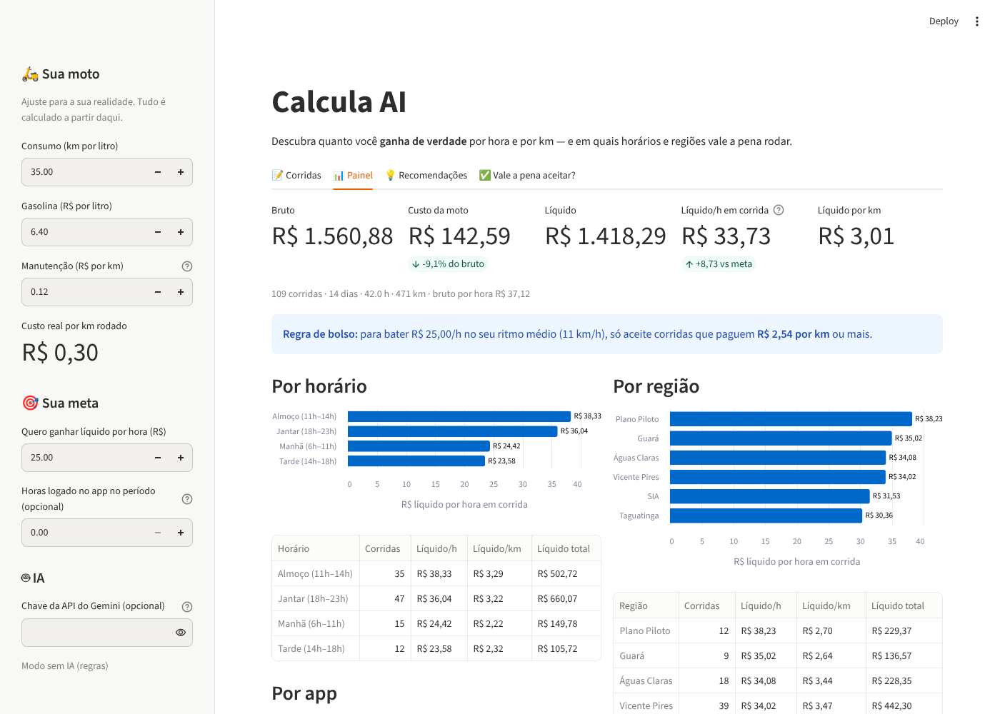
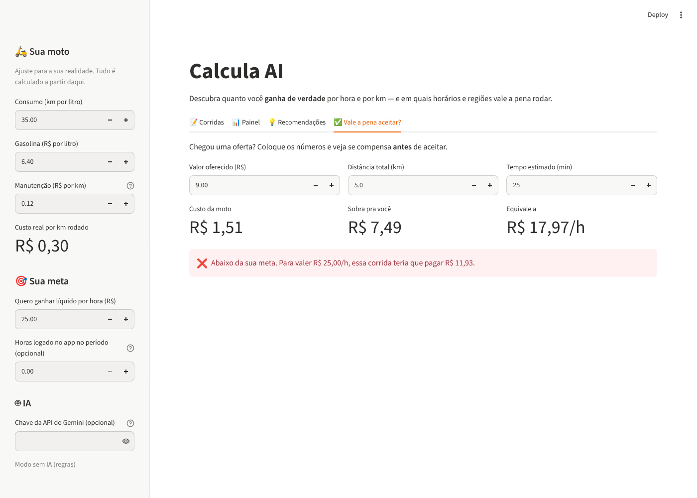

# 🛵 Calcula AI — assistente de ganhos para entregadores

**Demo:** [calcula-ai.streamlit.app](https://calcula-ai.streamlit.app)

Entregador de aplicativo vê o valor bruto de cada corrida, mas não sabe quanto **sobra de verdade** por hora e por km depois de pagar gasolina e manutenção da moto — nem quais horários e regiões compensam mais.

Eu sou entregador de moto em Brasília (iFood e 99) há 2 anos e construí o Calcula AI para responder essas perguntas com os meus próprios dados.



## O que o app faz

| Função | Como funciona |
|---|---|
| **Registro de corridas** | Formulário rápido, tabela editável e importação/exportação em CSV. |
| **Ganho real** | Desconta o custo da moto por km (combustível + manutenção) e mostra líquido total, por hora e por km. |
| **Hora em corrida × hora logado** | Opcionalmente, considera o tempo parado esperando pedido, que é o que mais derruba o ganho real. |
| **Painel** | Ranking de R$ líquido/hora por faixa de horário, região, app e dia da semana. |
| **Recomendações com IA** | Um LLM (Gemini) transforma as métricas em um plano prático: onde e quando rodar, o que evitar, quanto cobrar por km. |
| **Vale a pena aceitar?** | Antes de aceitar uma oferta, informa se ela paga a sua meta de R$/hora e qual seria o valor mínimo. |



## Decisões de projeto

- **O LLM não faz conta.** Toda a matemática fica em `calc.py`, de forma determinística e coberta por testes. A IA recebe só os números prontos (JSON) e é instruída a não inventar valores. Isso evita o erro clássico de LLM errando aritmética.
- **Médias ponderadas.** R$/hora de um grupo é `soma do líquido ÷ soma das horas`, não a média das taxas de cada corrida — senão corridas curtas distorcem o resultado. Há um teste específico para isso.
- **Resiliente a falhas da API.** Se o Gemini estiver sobrecarregado ou demorar, o app tenta de novo com espera crescente e, se persistir, passa para modelos reserva mais leves. Chave inválida não é repetida. Cada chamada tem tempo limite, então a tela nunca fica travada.
- **Funciona sem IA.** Sem chave de API (ou se todos os modelos falharem), o app gera as recomendações por regras e explica o motivo. O usuário nunca fica sem resposta.
- **Feito para o mundo real.** Aceita `18,50`, `R$ 18,50`, datas `10/11/2026` ou `2026-11-10`, e explica quais linhas foram ignoradas e por quê.
- **Sem banco de dados, por enquanto.** Os dados ficam na sessão do navegador e o usuário exporta o CSV. Foi uma escolha consciente para o MVP: zero custo e nenhum dado pessoal armazenado em servidor.

## Estrutura

```
app.py              interface (Streamlit)
calc.py             regras de cálculo (puras e testáveis)
ia.py               prompt + chamada ao Gemini (com nova tentativa e modelos reserva) + plano B por regras
tests/test_calc.py  testes das regras de cálculo
tests/test_ia.py    testes da nova tentativa, dos modelos reserva e do plano B
dados/corridas_exemplo.csv
```

## Como rodar

```bash
git clone https://github.com/andre-alves-ia/calcula-ai.git
cd calcula-ai
python -m venv .venv && source .venv/bin/activate   # Windows: .venv\Scripts\activate
pip install -r requirements-dev.txt
streamlit run app.py
```

Para ativar a IA, crie uma chave gratuita no [Google AI Studio](https://aistudio.google.com/apikey), copie `.streamlit/secrets.toml.example` para `.streamlit/secrets.toml` e cole a chave. Também dá para colar a chave direto na barra lateral do app.

Testes: `pytest` — 18 testes automatizados cobrindo as regras de cálculo e a camada de IA (sem chamar a API de verdade).

## Dados

`dados/corridas_exemplo.csv` traz **dados fictícios** gerados para demonstração (109 corridas em 14 dias em regiões do DF). Para usar com os seus dados, registre as corridas no app ou envie um CSV com as colunas:

`data, hora, app, regiao, valor, km, minutos`

## Próximos passos

- [ ] Persistência por usuário (login + banco de dados)
- [ ] Importar o histórico direto dos extratos dos apps
- [ ] Custos fixos mensais (parcela, seguro, plano de celular) no cálculo
- [ ] Versão mobile/PWA para registrar a corrida em 2 toques

---

Feito por **André Alves** · [LinkedIn](https://linkedin.com/in/andre-alves-ia) · [GitHub](https://github.com/andre-alves-ia)
Desenvolvido com Python, Streamlit, Pandas e Gemini, com apoio do Claude Code.
